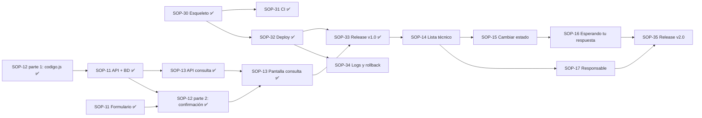

# AGENTS.md — Guía de trabajo del equipo SigueTuCaso

> **Léelo completo antes de tu primera tarea.** Es la fuente única de verdad sobre cómo trabajamos.
> Sirve para las personas del equipo **y** para la IA que cada uno use (Claude Code, Codex, Cursor, Copilot, ChatGPT…).
> Si algo de aquí cambia, se cambia **por Pull Request**, como cualquier código.

---

## 0. Cómo usar esta guía

**Si eres integrante del equipo**

1. Lee las secciones 1 a 4 (10 minutos).
2. Busca tu nombre en la sección 4: ahí está qué te toca, en qué orden, a quién esperas y a quién bloqueas.
3. Cuando vayas a trabajar con tu IA, ábrela **dentro de la carpeta del repo** y dile algo como:
   > "Lee AGENTS.md. Soy Nicolas Toro (Backend). Ayúdame con SOP-11 siguiendo la guía."

**Si eres una IA ayudando a un integrante**

- Antes de escribir código, lee este archivo completo, `README.md`, `CONTRIBUTING.md` y `docs/definicion-de-terminado.md`.
- Pregunta (o deduce del mensaje) **quién es la persona** y **qué clave de Jira (`SOP-X`)** va a trabajar. Sin clave, no empieces.
- Trabaja **solo** en el alcance de esa tarea (sección 4 y criterios de aceptación de la tarea en Jira).
- Respeta **exactamente** el contrato técnico de la sección 7 (nombres de archivos, tabla, endpoints, JSON). Si crees que hay que cambiarlo, **detente y díselo a la persona**: el cambio se acuerda con el equipo.
- Sigue las reglas de la sección 9 ("Reglas para la IA").

---

## 1. El producto en un minuto

**SigueTuCaso**: quien pide soporte TI reporta su problema **una sola vez**, recibe un **código de seguimiento** y consulta **en qué va su caso sin iniciar sesión**. El técnico ve **todas las solicitudes en un solo lugar**, cambia su estado y pide lo que le falta.

- **Problema (de las entrevistas):** nadie sabe en qué va su solicitud; insisten ~2 veces por caso; el técnico recibe 5–10 "¿en qué va mi caso?" al día y se le pierden casos.
- **Indicador de valor:** tiempo para conocer el estado de una solicitud. Hoy: 3–4 h. Meta: menos de 30 s.
- **Decisiones de océano azul que el código DEBE respetar:**
  - **Sin login** para el solicitante (eliminar). No agregues registro ni cuentas.
  - **Formulario corto** (reducir). No agregues campos que no estén en el contrato.
  - **Código de seguimiento** y estado **"Esperando tu respuesta" con nota** (crear).

| Recurso | Enlace |
|---|---|
| Tablero Jira | https://plag-soporte-eci.atlassian.net/jira/software/projects/SOP/boards/1 |
| Repositorio | https://github.com/plag-soporte-eci/siguetucaso |
| Demo desplegada | https://siguetucaso.onrender.com (salud: `/health`) |

---

## 2. Reglas de oro (no negociables)

1. **Todo trabajo tiene una tarjeta en Jira** (`SOP-X`). Si no existe, se le pide al PO antes de empezar.
2. **Nadie sube a `main` directo.** Rama → Pull Request → revisión de **otro** integrante → CI en verde → merge.
3. **La clave `SOP-X` va en la rama, en cada commit y en el título del PR.** Así Jira enlaza todo (trazabilidad).
4. **Toda historia lleva al menos una prueba automatizada** de lo importante (sección 7.6).
5. **Cero secretos en el repo.** Nada de `.env`, claves ni contraseñas. Solo `.env.example` con nombres de variables.
6. **Límite WIP: máximo 2 tarjetas por columna** "En curso" y "En revisión". Termina antes de empezar otra.
7. **Ningún PR espera más de 24 h por revisión** (acuerdo Lean). Si te piden revisión, es prioridad.
8. **Bloqueado = se avisa de inmediato**: marca la tarjeta con *flag* en Jira + comentario + mensaje al grupo.
9. **Uso de IA:** está permitido y se declara en el README (sección "Componentes reutilizados y uso de IA"). **No** se agregan firmas de IA en commits ni PR (`Co-Authored-By`, "Generated with…"). **Cada uno debe entender y poder explicar** todo lo que sube: en la sustentación preguntan individualmente.

---

## 3. Flujo de una tarea, paso a paso

```
Jira: Por hacer → En curso → En revisión (PR) → Finalizado
```

1. **Jira:** asígnate la tarjeta (si no lo está) y muévela a **En curso**.
2. **Rama** desde `main` actualizado:
   ```bash
   git checkout main && git pull
   git checkout -b feature/SOP-11-api-solicitudes
   ```
   Prefijos: `feature/` (funcionalidad), `fix/` (error), `chore/` (configuración), `docs/` (documentación).
3. **Programa** dentro del alcance. Commits pequeños que empiecen por la clave:
   ```
   SOP-11 crea tabla solicitudes y repositorio
   SOP-11 agrega POST /api/solicitudes con validaciones
   ```
4. **Pruebas:** `npm test` debe pasar en local. Agrega la prueba de tu historia.
5. **Prueba manual:** `npm run dev` y recorre la funcionalidad en el navegador.
6. **PR** hacia `main` con título `SOP-11 <qué hace>`, llenando la plantilla (qué cambia, cómo se probó, checklist de la DoD). Pide revisión según la tabla de la sección 4.4.
7. **Jira:** mueve la tarjeta a **En revisión (PR)**.
8. **Revisión:** quien revisa deja **al menos un comentario útil** (pregunta, sugerencia o "lo probé así y funcionó"), luego aprueba. Si pide cambios, se corrigen en la misma rama.
9. **Merge** (squash) cuando haya 1 aprobación y el CI esté en verde. La rama se borra sola.
10. **Verifica en la demo** (cuando exista) y mueve la tarjeta a **Finalizado**.

**Definición de Terminado:** `docs/definicion-de-terminado.md`. Si no cumple todo, **no está terminada**.

---

## 4. Quién hace qué

### 4.1 Equipo

| Integrante | Rol | Jira / GitHub |
|---|---|---|
| Juan Sebastián Ortega Muñoz | Product Owner + Developer | Dueño del backlog |
| Sebastián Albarracín Silva | Scrum Master + Developer Frontend | Dueño de `public/` y de los eventos y el tablero |
| Nicolas Toro | Developer – Backend y calidad | Dueño de `src/` (API y BD) y de las pruebas |
| David Salomón Baena Rubio | Developer – DevOps | Dueño de CI, despliegue, operación y releases |

"Dueño" = quien vela por la coherencia de esa parte. Cualquiera puede tocarla dentro de su tarea, pero el dueño revisa.

### 4.2 Sprints y calendario

| Sprint | Fechas | Objetivo |
|---|---|---|
| Sprint 0 · Arranque | 9 – 10 nov (cerrado) | Cliente, producto, repo, tablero y esqueleto |
| **Sprint 1 · Registro y consulta** | **10 nov 12:00 → jue 12 nov 12:00** | Un solicitante registra una solicitud y consulta su estado con un código, sin iniciar sesión |
| Sprint 2 · Gestión del técnico | 12 nov 13:00 → 19 nov | El técnico gestiona las solicitudes y el solicitante ve el avance, quién lo atiende y lo que le piden |

**El Sprint 1 dura 2 días. Lo que no se integre a `main` el miércoles 11 en la noche no entra en la demo.**

| Cuándo | Qué | Quién |
|---|---|---|
| Todos los días, 8:00 p. m. (10 min, Meet o WhatsApp) | **Daily:** qué hice, qué haré, qué me bloquea | Todos · facilita Sebastián A. |
| Mié 11, 11:59 p. m. | **Corte de código del Sprint 1** (todo en `main` y desplegado) | Todos |
| Jue 12, 8:00 a. m. | Release **v1.0** | David |
| Jue 12, mañana | **Sprint Review 1** con 2 usuarios reales (cronometrar el indicador) | Juan Sebastián + todos |
| Jue 12, antes de las 12:00 | **Retrospectiva 1** (una mejora, un responsable, cómo medirla) | Sebastián A. + todos |
| Jue 12, tarde | **Sprint Planning 2** | Todos |
| Mié 18, 11:59 p. m. | Corte de código del Sprint 2 | Todos |
| Jue 19 | Release **v2.0**, Review 2 y Retro 2 | Todos |

### 4.3 Tareas de cada uno

#### Juan Sebastián Ortega — Product Owner + Developer

| Orden | Tarea | Sprint | Depende de | Bloquea a |
|---|---|---|---|---|
| 1 | **SOP-36** Guía del equipo (este archivo) ✅ | 1 | — | A todos (contrato técnico) |
| 2 | **SOP-12 · H2 parte 1:** `src/services/codigo.js` + su prueba (generador del código) — **hoy mismo, PR pequeño** ✅ | 1 | — | Nicolas (SOP-11 lo usa) |
| 3 | **SOP-12 · H2 parte 2:** pantalla de confirmación con el código y botón "Copiar" (coordinar con Sebastián A.) ✅ | 1 | SOP-11 (formulario y API) | SOP-13 |
| 4 | Preparar y dirigir la **Sprint Review 1** con 2 usuarios; medir el indicador | 1 | SOP-33 (v1.0) | — |
| 5 | Repriorizar el backlog con el feedback; aceptar o rechazar historias | 1–2 | — | Planning 2 |

#### Sebastián Albarracín Silva — Scrum Master + Developer Frontend

| Orden | Tarea | Sprint | Depende de | Bloquea a |
|---|---|---|---|---|
| 1 | **SOP-11 · H1 parte frontend:** `public/index.html` con el formulario guiado y validaciones en el navegador. **Empieza ya contra el contrato de la sección 7.4** (no esperes la API) ✅ | 1 | — | SOP-12 parte 2 |
| 2 | **SOP-13 · H3 parte frontend:** `public/consultar.html` con el campo del código y la línea de pasos del estado ✅ | 1 | Contrato 7.4 (probar con la API de la tarea 7 cuando esté) | Review 1 |
| 3 | Revisar que todo funcione en celular | 1 | — | Review 1 |
| 4 | Pantallas del técnico `public/tecnico.html` para **SOP-14, SOP-15, SOP-16, SOP-17** (con cada dueño) | 2 | API de cada historia | SOP-35 |
| 5 | Organizar la **daily** de las 8 p. m. y guardar evidencia (captura o nota corta de cada una) | 1–2 | — | — |
| 6 | Vigilar el tablero: WIP ≤ 2, bloqueos con *flag*, PR sin revisar > 24 h | 1–2 | — | — |
| 7 | **SOP-13 · H3 parte backend:** `GET /api/solicitudes/:codigo` + prueba ✅ | 1 | SOP-11 parte backend | SOP-13 pantalla |
| 8 | Registrar las **métricas Lean** al final de cada sprint: tiempo de ciclo por historia (reporte *Cycle time* de Jira) e historias terminadas | 1–2 | — | Retro |
| 9 | Facilitar la **retrospectiva**: identificar 2 desperdicios reales, elegir 1 mejora, responsable y cómo medirla | 1–2 | Review | — |
| 10 | **SOP-17 · H7** Asignar responsable (API + prueba; pantalla con Sebastián A.) | 2 | SOP-14 | SOP-35 |

#### Nicolas Toro — Developer Backend y calidad

| Orden | Tarea | Sprint | Depende de | Bloquea a |
|---|---|---|---|---|
| 1 | **SOP-11 · H1 parte backend:** `src/constantes.js`, `src/schema.sql`, `src/initDb.js`, `src/repositories/solicitudes.js`, `POST /api/solicitudes` + pruebas. **Es la tarea más urgente del sprint** ✅ | 1 | SOP-12 parte 1 (si aún no está, usar un código temporal y reemplazarlo) | Sebastián A. (SOP-13), Juan Sebastián (SOP-12 parte 2), Sebastián A. (integración) |
| 2 | Ayudar a que las pruebas de los demás usen pg-mem bien (sección 7.6) | 1–2 | — | — |
| 3 | **SOP-15 · H5** Cambiar estado (API + prueba) | 2 | SOP-14 | SOP-16 |
| 4 | **SOP-16 · H6** "Esperando tu respuesta" con nota (API + prueba) | 2 | SOP-15 | SOP-35 |

#### David Salomón Baena Rubio — Developer DevOps

| Orden | Tarea | Sprint | Depende de | Bloquea a |
|---|---|---|---|---|
| 1 | **SOP-31** CI con GitHub Actions + exigir el check en la protección de `main` — **hoy** ✅ | 1 | — (SOP-30 ya está) | Todos los PR siguientes |
| 2 | **SOP-32** Despliegue en Render + Neon (auto-deploy desde `main`, health check en `/health`) — **a más tardar mié 11 en la mañana** ✅ | 1 | — | Review 1, SOP-33 |
| 3 | **SOP-33** Release v1.0 (versión `1.0.0`, tag, notas) ✅ | 1 | SOP-11, 12, 13 y 32 | Review 1 |
| 4 | **SOP-14 · H4** Lista centralizada del técnico + middleware de clave (API + prueba) | 2 | SOP-33 | SOP-15, SOP-17 |
| 5 | **SOP-34** Logs, salud y rollback (con simulacro y capturas) | 2 | SOP-32 | — |
| 6 | **SOP-35** Release v2.0 | 2 | SOP-14 a 17 | Review 2 |

### 4.4 Quién revisa a quién (para no esperar)

| Autor del PR | Revisa | Si no está disponible |
|---|---|---|
| Juan Sebastián | Nicolas | Sebastián A. |
| Sebastián A. | Juan Sebastián | Nicolas |
| Nicolas | David | Juan Sebastián |
| David | Nicolas | Sebastián A. |

### 4.5 Mapa de dependencias



**Camino crítico del Sprint 1** (si uno se atrasa, se atrasa la demo):
`SOP-12 parte 1 → SOP-11 API → SOP-13 API → SOP-13 pantalla → SOP-33 v1.0`, en paralelo con `SOP-31 → SOP-32`.

---

## 5. Cómo ejecutar el proyecto

```bash
npm install
cp .env.example .env      # llena los valores (pídelos al equipo, nunca los subas)
npm run dev               # http://localhost:3000  y  http://localhost:3000/health
npm test                  # pruebas
```

Sin `DATABASE_URL` la app arranca igual. Para probar con base real, David comparte por privado la cadena de Neon (o usa un PostgreSQL local).

---

## 6. Evidencias que cada uno debe dejar (criterio individual, 15 %)

La nota individual se basa en **aportes verificables**. Asegúrate de tener, a tu nombre:

- [ ] Al menos **1 PR propio** por sprint, con la clave `SOP-X`.
- [ ] Al menos **1 revisión con comentario útil** a un PR de otro por sprint.
- [ ] Tus tarjetas de Jira movidas por **ti** (Jira guarda quién movió qué).
- [ ] Participación en las dailies, la Review y la Retro.
- [ ] Notas personales cortas: qué hiciste, qué te costó, qué aprendiste (te sirven para la reflexión individual y para las preguntas de la sustentación).

---

## 7. Contrato técnico (obligatorio para todos y para la IA)

### 7.1 Estructura de carpetas

```
src/
  app.js                    # monta middlewares y rutas (ya existe)
  server.js                 # arranca el servidor y llama a initDb (ya existe)
  db.js                     # pool de pg (ya existe; las pruebas reemplazan db.pool)
  constantes.js             # ESTADOS y SERVICIOS            → Nicolas (SOP-11)
  schema.sql                # tabla solicitudes               → Nicolas (SOP-11)
  initDb.js                 # ejecuta schema.sql al arrancar  → Nicolas (SOP-11)
  services/codigo.js        # generarCodigo()                 → Juan Sebastián (SOP-12)
  repositories/solicitudes.js  # todas las consultas SQL       → Nicolas (SOP-11) y se amplía en S2
  middleware/tecnicoAuth.js # valida la clave del técnico     → David (SOP-14)
  routes/health.js          # ya existe
  routes/solicitudes.js     # API pública                     → Nicolas (POST) y Sebastián A. (GET)
  routes/tecnico.js         # API del técnico                 → Sprint 2
public/
  index.html                # formulario de reporte + confirmación  → Sebastián A. (SOP-11, SOP-12)
  consultar.html            # consulta por código                   → Sebastián A. (SOP-13)
  tecnico.html              # panel del técnico                     → Sprint 2
  styles.css                # estilos compartidos
  js/                       # un archivo JS por página (index.js, consultar.js, tecnico.js)
tests/
  helpers/dbMemoria.js      # crea la base pg-mem para las pruebas  → Nicolas (SOP-11)
  *.test.js                 # una prueba por historia
```

**Regla:** las rutas no escriben SQL; llaman funciones de `repositories/solicitudes.js`. Así el SQL vive en un solo lugar.

### 7.2 Constantes (`src/constantes.js`)

```js
const ESTADOS = ['Recibida', 'En revisión', 'Esperando tu respuesta', 'Resuelta'];
const SERVICIOS = [
  'Plataforma académica',
  'Correo institucional',
  'WiFi / red',
  'VPN',
  'Equipo / computador',
  'Otro',
];
module.exports = { ESTADOS, SERVICIOS };
```

El frontend usa **exactamente** estos textos.

### 7.3 Base de datos (`src/schema.sql`)

La tabla se crea **completa desde el Sprint 1** (las columnas del Sprint 2 quedan vacías) para no tener que migrar después.

```sql
CREATE TABLE IF NOT EXISTS solicitudes (
  id              SERIAL PRIMARY KEY,
  codigo          TEXT NOT NULL UNIQUE,
  nombre          TEXT NOT NULL,
  correo          TEXT NOT NULL,
  servicio        TEXT NOT NULL,
  descripcion     TEXT NOT NULL,
  desde_cuando    TEXT,
  que_intento     TEXT,
  estado          TEXT NOT NULL DEFAULT 'Recibida',
  responsable     TEXT,
  nota_tecnico    TEXT,
  creado_en       TIMESTAMPTZ NOT NULL DEFAULT NOW(),
  actualizado_en  TIMESTAMPTZ NOT NULL DEFAULT NOW()
);
```

- La validación de `estado` y `servicio` se hace en el código con las constantes (pg-mem no soporta bien `CHECK`).
- En la base las columnas van en `snake_case`; en el JSON de la API van en `camelCase` (el repositorio convierte).

### 7.4 API

Todas las respuestas son JSON. Errores: `{ "error": "mensaje para mostrar al usuario" }`; los de validación agregan `"campos": { "<campo>": "mensaje" }`.

**Públicas (solicitante, sin login)**

| Método y ruta | Historia | Cuerpo / parámetros | Respuesta OK | Errores |
|---|---|---|---|---|
| `POST /api/solicitudes` | SOP-11 (+ SOP-12) | `{ nombre, correo, servicio, descripcion, desdeCuando?, queIntento? }` | **201** `{ codigo, estado, creadoEn }` | **400** con `campos` (obligatorio vacío, correo inválido, servicio no válido, descripción > 1000 caracteres) |
| `GET /api/solicitudes/:codigo` | SOP-13 (+ S2) | `codigo` sin importar mayúsculas ni espacios | **200** `{ codigo, servicio, estado, creadoEn, actualizadoEn, responsable, notaTecnico }` | **404** `{ error: "No encontramos una solicitud con ese código. Revisa que esté bien escrito." }` |

- La consulta pública **nunca** devuelve `nombre` ni `correo`.
- `responsable` y `notaTecnico` son `null` hasta el Sprint 2. `notaTecnico` solo se envía cuando el estado es "Esperando tu respuesta".

**Del técnico (Sprint 2)** — todas exigen el encabezado `X-Tecnico-Clave` igual a la variable de entorno `TECNICO_PASSWORD`; si no coincide → **401** `{ error: "Clave incorrecta" }`.

| Método y ruta | Historia | Cuerpo / parámetros | Respuesta OK |
|---|---|---|---|
| `GET /api/tecnico/solicitudes?estado=` | SOP-14 | `estado` opcional | **200** `{ abiertas, solicitudes: [ {…todos los campos} ] }`, más recientes primero |
| `GET /api/tecnico/solicitudes/:codigo` | SOP-14 | — | **200** detalle completo |
| `PATCH /api/tecnico/solicitudes/:codigo/estado` | SOP-15, SOP-16 | `{ estado, nota? }` (`nota` obligatoria si `estado` = "Esperando tu respuesta", máx. 300) | **200** solicitud actualizada · **400** estado inválido o falta la nota |
| `PATCH /api/tecnico/solicitudes/:codigo/responsable` | SOP-17 | `{ responsable }` | **200** solicitud actualizada |

Cada cambio del técnico actualiza `actualizado_en`.

### 7.5 Código de seguimiento (`src/services/codigo.js`, SOP-12)

- Formato `TK-XXXX`: 4 caracteres en mayúscula del alfabeto `ABCDEFGHJKLMNPQRSTUVWXYZ23456789` (sin 0, O, 1, I).
- Exporta `generarCodigo()` (devuelve un texto) y `normalizarCodigo(texto)` (mayúsculas y sin espacios).
- Si al guardar hay choque por `UNIQUE`, el repositorio reintenta con otro código (máx. 5 veces).

### 7.6 Pruebas

- Jest + Supertest contra `app` (sin levantar servidor). Corren con `NODE_ENV=test`.
- **Nunca** usan una base real. Usan pg-mem con el mismo `schema.sql`:

```js
// tests/helpers/dbMemoria.js
const fs = require('fs');
const path = require('path');
const { newDb } = require('pg-mem');
const { db } = require('../../src/db');

function usarBaseEnMemoria() {
  const mem = newDb();
  const { Pool } = mem.adapters.createPg();
  db.pool = new Pool();
  const schema = fs.readFileSync(path.join(__dirname, '../../src/schema.sql'), 'utf8');
  return db.pool.query(schema);
}
module.exports = { usarBaseEnMemoria };
```

- Cada historia trae su **prueba automatizada mínima** en la descripción de su tarjeta de Jira. Esa es la que no puede faltar.
- Nombre del archivo: `tests/<tema>.test.js` (por ejemplo `tests/solicitudes.test.js`, `tests/codigo.test.js`).

### 7.7 Frontend

- HTML, CSS y JavaScript **planos**. Sin frameworks, sin librerías externas, sin build.
- Español, lenguaje sencillo, pensado para **celular primero**.
- Las llamadas a la API con `fetch` a rutas relativas (`/api/...`), nunca a `localhost` fijo.
- Mensajes de error claros y junto al campo que falla.
- En `tecnico.html`, la clave se guarda en `sessionStorage` y se envía en `X-Tecnico-Clave`.

### 7.8 Variables de entorno

| Variable | Para qué | Dónde se configura |
|---|---|---|
| `PORT` | Puerto local (3000) | `.env` local / Render la pone sola |
| `DATABASE_URL` | Conexión a PostgreSQL (Neon) | `.env` local y panel de Render |
| `TECNICO_PASSWORD` | Clave del panel del técnico | `.env` local y panel de Render |
| `NODE_ENV` | `test` en pruebas, `production` en Render | Automático |

---

## 8. Cuando algo sale mal

| Situación | Qué hacer |
|---|---|
| Estoy bloqueado por otra tarea | *Flag* en Jira + comentario explicando qué esperas + mensaje al grupo. Sebastián A. (Scrum Master) ayuda a destrabar. Mientras tanto, avanza contra el contrato (sección 7) con datos de prueba. |
| El CI falla en mi PR | Corre `npm test` en local, corrige en la misma rama y vuelve a subir. Nunca se desactiva una prueba para pasar. |
| Conflicto de merge | `git checkout main && git pull`, luego `git checkout mi-rama && git merge main`, resuelve, prueba y sube. Si es en un archivo de otro, pregúntale. |
| La demo en Render está caída | Avisa a David. Él revisa los logs y, si hace falta, hace rollback (SOP-34). |
| Creo que el contrato de la sección 7 está mal | No lo cambies solo: proponlo en el grupo y, si se acepta, se cambia este archivo por PR. |
| La historia no cabe en el sprint | Avisa al PO **antes** del corte. Es mejor partirla que entregarla a medias. |

---

## 9. Reglas para la IA (cualquier asistente que trabaje en este repo)

**Siempre**

- Lee este archivo antes de proponer código. Confirma con la persona **su nombre** y **la clave `SOP-X`**.
- Antes de programar, resume en 3–5 líneas qué vas a hacer y qué archivos vas a tocar, y espera el visto bueno.
- Respeta el contrato de la sección 7: rutas, nombres de archivos, columnas, JSON y textos de estados/servicios.
- Escribe código **simple y comentado en español**, entendible para un estudiante. La persona debe poder explicarlo en la sustentación.
- Crea o actualiza la prueba automatizada de la historia y ejecuta `npm test` antes de proponer el commit.
- Usa la rama `feature|fix|chore|docs/SOP-X-descripcion` y commits que empiecen por `SOP-X `. Muestra el mensaje antes de cada commit.
- Al abrir el PR, llena `.github/pull_request_template.md` completo.
- Al terminar, explica a la persona qué hiciste y cómo probarlo, en lenguaje simple.

**Nunca**

- Nunca hagas push directo a `main`, ni fuerces (`--force`), ni desactives la protección de ramas o pruebas.
- Nunca agregues firmas de IA en commits o PR (`Co-Authored-By: …`, "Generated with …").
- Nunca subas `.env`, claves, contraseñas o cadenas de conexión.
- Nunca agregues login, frameworks (React, Vue, Next, Tailwind…), TypeScript, ORMs, Docker ni dependencias nuevas sin que el equipo lo acuerde.
- Nunca modifiques archivos fuera del alcance de la tarea "de paso". Si ves algo que arreglar, sugiérelo como tarea nueva.
- Nunca cambies el contrato técnico (sección 7) sin decírselo a la persona para que lo acuerde con el equipo.
- Nunca inventes resultados de pruebas: si no las corriste, dilo.
